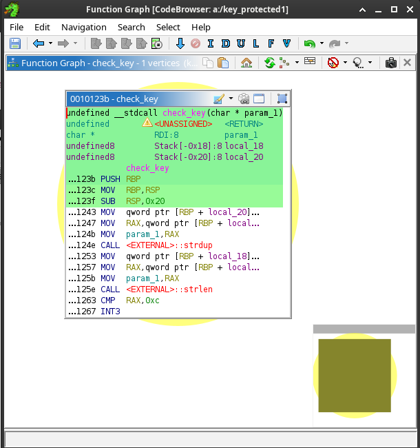
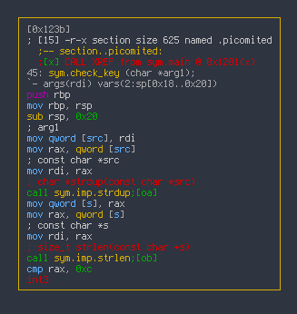

## PROJECT: picoMites, A Minimal Nanomites Implementation

Nanomites is a technique that splits program execution between two processes, essentially working in tandem, abusing the system debugging interface as a communication channel. The fact that the debugging interface is used for communication makes the technique very difficult to neutralize, and the debugging process itself can be cumbersome. The technique was introduced in 1999 by Silicon Realms as part of its Armadillo Protector, intended to protect software from being cracked. Despite its age, it’s an interesting exercise to implement, and it makes extensive use of `ptrace`, so it looks like an excellent final project for Chapter 1.

Let’s see how it works.

*   We'll have two processes: a parent process and a child process. The parent process will trace the child process.
*   An external tool is used to substitute any conditional (and potentially unconditional) jumps in the code with breakpoint instructions and create a table of the program address and associated conditions substituted.
*   During normal execution, the child process will eventually hit the injected breakpoints. The parent process takes control and, based on the address of the fired breakpoint and the previously generated table, determines whether the jump has to happen or not, updating the instruction pointer accordingly.
*   When trying to run this in a debugger, you’ll get continuous breakpoint activations, and step-by-step execution becomes really difficult.

As you can see, implementing this kind of technique requires an external tool with disassembling capabilities, at least for x86 machines where the machine code is variable-length and blindly looking for jump instruction opcodes may end up patching something that is not a jump instruction.

This external tool has to do something like the following:

*   Scan the part of the program that will be protected. You usually don’t apply your nanomites to the whole program, but just to some part of it that you want to protect. The protection technique itself has a performance penalty, so applying it to all the code will reduce the program speed for little or no profit.
*   For each jump instruction found:
    *   Identify the conditional jump (flag that should be checked) and store it.
    *   Store the address associated with this jumping instruction (the `RIP` value).
    *   Store the target address of the jumping instruction.
    *   Store the size of the jumping instruction, or the address to the next instruction. Note that this is only required for architectures with variable-length instructions, like Intel processors.
    *   Substitute the jumping instruction with a software breakpoint.

Note that the parent process never restores the original code; it kind of interprets it. Then, at runtime:

*   The parent process starts tracing the child process.
*   Every time the child process hits a breakpoint, the parent gets control back.
    *   Parent process reads the processor’s registers. This includes flags and the current instruction pointer.
    *   Use the instruction pointer to find the associated table entry, if any.
    *   Check the stored associated flag against the current flags.
        *   If the flag matches, set IP to the stored target address.
        *   Otherwise, update it with the jump instruction size or the next instruction address (whatever you’ve decided to store in your table).

As you can see, conceptually it’s not that complicated to implement; however, reversing this kind of programs may be tricky. Let’s start by writing a small program to be protected by our personal and simpler nanomites implementation. Let’s call them picoMites :) . Let’s also make our test program pretty simple, but with enough jumps to demonstrate the technique. This is why I added so many nested `ifs`.

```C
#include <stdio.h>
#include <string.h>
#define PICOMITED __attribute__((section(".picomited")))

PICOMITED int
check_key (char *key) {
  char *k = strdup (key);
  
  if (strlen(k) != 12) {
    
    for (int i = 0; i < 13; i++) {
      if (k[i] >= '0' && k[i] <= '9') k[i] -= '0';
    }
    if (k[0] + (k[2] * 10) + k[3] == 0x42) { //
      if (k[7] >= 'A' && k[7] <= 'Z') {
		  if (k[8] >= 'A' && k[8] <= 'Z') {
			  if (k[9] >= 'A' && k[9] <= 'Z') {
				  if (((k[8] + k[11]) == (k[9] + k[12])) && (k[7] + k[1] == k[9])) {
					  if (k[10] == '-' && k[6] == '-') {
						  if (k[4] == k[5] + 2) {
							  return 1;
						  }
					  }
				  }
			  }
		  }
      }
    } 
  }
  return 0;
}

int main () {
  char  input[1024];
  
  puts ("Key protected program");
  printf ("%s", "Enter your product key: ");

  fgets (input, 1024, stdin);
  input[strlen(input) - 1] = 0; // Remove \n
  if (check_key (input)) {
    puts ("Key verification Correct. Running application");
    getchar ();
  } else {
    puts ("Key verification failed. Access denied");
    getchar ();
  }
}
```

This is a typical serial number/key checker example. We’d like to protect the `check_key` function, so we put it in its own section to easily find and process it. We can actually extract all the information required to implement our picoMites with the following command:

    $ objdump -j .picomited -d key_protected | grep j
        1267:	0f 84 38 02 00 00    	je     14a5 <check_key+0x26a>
        1274:	eb 50                	jmp    12c6 <check_key+0x8b>
        1288:	7e 38                	jle    12c2 <check_key+0x87>
        129c:	7f 24                	jg     12c2 <check_key+0x87>
        12ca:	7e aa                	jle    1276 <check_key+0x3b>
        1303:	0f 85 9c 01 00 00    	jne    14a5 <check_key+0x26a>
        1316:	0f 8e 89 01 00 00    	jle    14a5 <check_key+0x26a>
        1329:	0f 8f 76 01 00 00    	jg     14a5 <check_key+0x26a>
        133c:	0f 8e 63 01 00 00    	jle    14a5 <check_key+0x26a>
        134f:	0f 8f 50 01 00 00    	jg     14a5 <check_key+0x26a>
        1362:	0f 8e 3d 01 00 00    	jle    14a5 <check_key+0x26a>
        1375:	0f 8f 2a 01 00 00    	jg     14a5 <check_key+0x26a>
        142b:	75 78                	jne    14a5 <check_key+0x26a>
        145b:	75 48                	jne    14a5 <check_key+0x26a>
        146a:	75 39                	jne    14a5 <check_key+0x26a>
        1479:	75 2a                	jne    14a5 <check_key+0x26a>
        149c:	75 07                	jne    14a5 <check_key+0x26a>
        14a3:	eb 05                	jmp    14aa <check_key+0x26f>

This is a typical serial number/key checker example. We’d like to protect the `check_key` function, so we put it in its own section to easily find and process it. We can actually extract all the information required to implement our picoMites with the following command:

The `objdump` command will just dump the disassembly of the `.picomited` section. Then, as all Intel jumping instructions start with a `j`, we just grep for that character to get the listing of all jumps in that fragment of code. In other platforms or if we want to patch other instructions, we may need a more complicated method, but for our picoMites implementation, this is perfect.

Now, we just need to patch all those entries and build the table with the source addresses, the target addresses, the instruction size, and the flag. And yes, all that information is in the output of the `objdump` we’ve just shown above.

```bash
$ objdump -j .picomited -d key_protected | grep j > picomites.lst
```

The command above stores this data in a file. Now, we just need to write a small program to produce the picoMites table.

### Creating the picoMites table

The first tool we need is a small program to produce the picoMites table that we’ll need in order to run our protected program. This tool will also patch the program changing jumps for `int3` instructions. I’ll only implement the jumps used by our test program so we’ve a working example with a relatively short length. A complete implementation should implement all possible jumps for the target architecture. Please refer to Intel programming manuals for a complete list of jumping instructions for the x86 architecture.

I have to say that I don’t write the most beautiful code when it comes down to parsing strings, and I’m pretty sure you can improve this program a lot; that is something you can take as an exercise to improve your C programming skills.


```C
#include <stdio.h>
#include <stdint.h>
#include <string.h>
#include <stdlib.h>
#include <unistd.h>
#include <fcntl.h>

#define DIE(s) {perror(s); exit(1);}

char *cond[] = {"ne", "le", "mp", "g", "e", NULL};

int main (int argc, char *argv[]) {
  FILE *fi = fopen (argv[1], "rt");
  int   f = open (argv[2], O_WRONLY);
  
  if (fi == NULL || f < 0) DIE ("cannot open files");
  printf ("struct picomite_t pm[] = {\n");
  while (!feof (fi)) {
    char buf[1024], trash[1024], flags[16];
    uint64_t offset, target;
    
    if (!fgets (buf, 1024, fi)) break;
    char *aux = strchr (buf, ':');
    if (!aux) DIE ("malformed string:");
    *aux = 0;
    aux++;
    sscanf (buf, "%x", &offset);
    
    char *aux1 = strchr (aux, 'j');
    if (!aux1) DIE ("malformed string");

    *aux1 = 0;
    while (*aux == ' ' || *aux == '\t') aux++;;
    int cnt = 0;
    for (int i = 0; i < strlen(aux); i++) if (aux[i] != ' ' && aux[i+1] == ' ') cnt++;
    
    aux1++;
    
    sscanf (aux1, "%s %x %s", flags, &target, trash);
    int i;
    for (i = 0; cond[i] != NULL; i++) if (!strcmp(cond[i], flags)) break;
    printf ("{0x%x, 0x%x, 0x%x, %d, \"%s\"},\n", offset + 1, target, offset + cnt,
	    cond[i] == NULL ? -1 : i, flags);
    uint8_t int3[1] = {0xcc};
    lseek (f, offset, SEEK_SET);
    write (f, &int3, 1);
  }
  printf ("{0,0,0,0,NULL}};\n");
  fclose (fi);
  close (f);
}
```

This program will dump into the console a C array containing all the information we need to run the patched program. The structure used to store the picoMites is the following:

```C
struct picomite_t {
  uint64_t offset;
  uint64_t target1;
  uint64_t target0;
  uint64_t c;
  char     *flags;
};
```

This program will dump into the console a C array containing all the information we need to run the patched program. The structure used to store the picoMites is the following:

We’ll have to also use it for the run-time execution program. The meaning of the fields is as follows:

* `offset`: This is the offset in the program where the jumping instruction was. We’ll use this field for finding the correct picomite based on the `RIP` register value and the program's base address. I’ll just do a linear search, but you get these offsets in order so you can implement a binary search which will really improve speed, especially if you have a lot of picomites.
* `target1` and `target0`: Are the offset to jump to if the condition is true or false respectively. For absolute jumps we just use `target1`.
* `c`: Is an integer indicating which jump condition we have to simulate so we can identify it quickly at run-time.
* `flags`: Is just the last part of the jump instruction that tells us which flags to check. This is not really needed but is useful for visualization during debugging.

The program opens the dump from `objdump` and the original binary that has to be modified. Then parses each line from the `objdump` output like this:

* Look for a `:`. Everything before that is the offset to the picomite.
* For the rest of the string look for a `j`. This splits the line between the instruction opcodes and the instruction mnemonic.
* For the final part of the string skip the `j` and read the flags (for `jle` the flags are `le`) and the target address. `objdump` shows it as an offset (for PIE binaries) which is very convenient.
* For whatever is in between the offset and the mnemonic, count spaces. That is the number of opcodes for the instruction and also the number of bytes to the next instruction in case the condition associated to the jump doesn’t hold. Note that for architectures with a fixed instruction length we can skip this step as the value will always be the same.
* Write `0xcc` (or whatever code fires a break point for your architecture) at the offset read from the `objdump` in the binary file to patch the selected jump.

If you compile and run this program against our current test, you'll get something like this:

    $ cp key_protected key_protected1
    $ objdump -j .picomited -d key_protected1 | grep j > picomites.lst
    $ ./picomites picomites.lst key_protected1
    struct picomite_t pm[] = {
    {0x1268, 0x14a5, 0x126d, 4, "e"},
    {0x1275, 0x12c6, 0x1276, 2, "mp"},
    {0x1289, 0x12c2, 0x128a, 1, "le"},
    {0x129d, 0x12c2, 0x129e, 3, "g"},
    {0x12cb, 0x1276, 0x12cc, 1, "le"},
    {0x1304, 0x14a5, 0x1309, 0, "ne"},
    {0x1317, 0x14a5, 0x131c, 1, "le"},
    {0x132a, 0x14a5, 0x132f, 3, "g"},
    {0x133d, 0x14a5, 0x1342, 1, "le"},
    {0x1350, 0x14a5, 0x1355, 3, "g"},
    {0x1363, 0x14a5, 0x1368, 1, "le"},
    {0x1376, 0x14a5, 0x137b, 3, "g"},
    {0x142c, 0x14a5, 0x142d, 0, "ne"},
    {0x145c, 0x14a5, 0x145d, 0, "ne"},
    {0x146b, 0x14a5, 0x146c, 0, "ne"},
    {0x147a, 0x14a5, 0x147b, 0, "ne"},
    {0x149d, 0x14a5, 0x149e, 0, "ne"},
    {0x14a4, 0x14aa, 0x14a5, 2, "mp"},
    {0,0,0,0,NULL}};

_NOTE: Actual values would likely be different at your box depending on your system configuration_.

You can now take a look inside `key_generated1` and see how all jumps in the `check_key` function are gone and substituted by `int3`. You will also see wrong instructions here and there as we are just injecting an `int3` and leaving any other bytes used by the original jump instruction unmodified. That may cause problems to some disassemblers. Note however that the wrong instructions are, once again, an x86 artifact due to its variable length instruction encoding. On an ARM or RISC-V everything will align nicely.

    $ objdump -d key_protected1 | grep -A 25 "<check_key>:"
    000000000000123b <check_key>:
        123b:	55                   	push   %rbp
        123c:	48 89 e5             	mov    %rsp,%rbp
        123f:	48 83 ec 20          	sub    $0x20,%rsp
        1243:	48 89 7d e8          	mov    %rdi,-0x18(%rbp)
        1247:	48 8b 45 e8          	mov    -0x18(%rbp),%rax
        124b:	48 89 c7             	mov    %rax,%rdi
        124e:	e8 2d fe ff ff       	call   1080 <strdup@plt>
        1253:	48 89 45 f0          	mov    %rax,-0x10(%rbp)
        1257:	48 8b 45 f0          	mov    -0x10(%rbp),%rax
        125b:	48 89 c7             	mov    %rax,%rdi
        125e:	e8 dd fd ff ff       	call   1040 <strlen@plt>
        1263:	48 83 f8 0c          	cmp    $0xc,%rax
        1267:	cc                   	int3  <----------------------- Break Point
        1268:	84 38                	test   %bh,(%rax) <----------- Junk Code starts
        126a:	02 00                	add    (%rax),%al
        126c:	00 c7                	add    %al,%bh
        126e:	45 fc                	rex.RB cld
        1270:	00 00                	add    %al,(%rax)
        1272:	00 00                	add    %al,(%rax) <---------- Junk Code ends
        1274:	cc                   	int3 <----------------------- Break Point
        1275:	50                   	push   %rax <---------------- Junk Code
        1276:	8b 45 fc             	mov    -0x4(%rbp),%eax
        1279:	48 63 d0             	movslq %eax,%rdx
        127c:	48 8b 45 f0          	mov    -0x10(%rbp),%rax
        1280:	48 01 d0             	add    %rdx,%rax

Try to open the file with Ghidra or radare2 and they will be pretty confused.

### The picoMites runtime

Now that we’ve the binary patched and our table to reconstruct the correct behavior at run-time, we can write our picoMites runtime. Remember, we’ll have two programs running in parallel. One will be tracing the other and executing the jumping instructions we intentionally removed from the original one. In practice, despite that there are two separate processes involved, one single source code will implement both, forking and tracing the child process. I kept it as two different programs because I think it's easier to follow this way.

The runtime code will be surprisingly simple. However, I’ll show it in pieces to make it easier to follow. Let’s start with the type declarations and the inclusion of the picomites table we created in the previous step:

```C
#include <stdio.h>
#include <stdint.h>
#include <stdlib.h>
#include <string.h>
#include <unistd.h>
#include <sys/ptrace.h>
#include <sys/wait.h>
#include <sys/user.h>

#define DIE(s) {perror(s); exit(1);}

struct picomite_t {
  uint64_t offset;
  uint64_t target1;
  uint64_t target0;
  uint64_t c;
  char     *flags;
};

char *cond[] = {"jne", "jle", "jmp", "jg", "je", NULL};

struct picomite_t pm[] = {
  {0x1268, 0x1512, 0x126d, 4, "e"},
  {0x1275, 0x12c6, 0x1276, 2, "mp"},
  {0x1289, 0x12c2, 0x128a, 1, "le"},
  {0x129d, 0x12c2, 0x129e, 3, "g"},
  {0x12cb, 0x1276, 0x12cc, 1, "le"},
  {0x1304, 0x1512, 0x1309, 0, "ne"},
  {0x1326, 0x1512, 0x132b, 1, "le"},
  {0x1339, 0x1512, 0x133e, 3, "g"},
  {0x135b, 0x1512, 0x1360, 1, "le"},
  {0x136e, 0x1512, 0x1373, 3, "g"},
  {0x1390, 0x1512, 0x1395, 1, "le"},
  {0x13a3, 0x1512, 0x13a8, 3, "g"},
  {0x1468, 0x1512, 0x146d, 0, "ne"},
  {0x149c, 0x1512, 0x149d, 0, "ne"},
  {0x14ba, 0x1512, 0x14bb, 0, "ne"},
  {0x14c9, 0x1512, 0x14ca, 0, "ne"},
  {0x14fb, 0x1512, 0x14fc, 0, "ne"},
  {0x1511, 0x1517, 0x1512, 2, "mp"},
  {0,0,0,0,NULL}};

int
find_picomite (uint64_t base, uint64_t a) {
  int i;
  for (i = 0; pm[i].offset != 0; i++)
    if (a == (base + pm[i].offset)) return i;
  return -1;
}
```

Here you can see the picoMites struct we’ve already discussed and the table we produced with our external tool. I’ve included in this piece of code a helper function which, given a pointer, will check if it corresponds with a picomite. Note that we have to pass in the base address for the program because at run-time RIP will be an absolute pointer and we only have offsets to the original jumps.

> **A note on performance**
>
> You may have noted that the implementation of the function to find the picomites is pretty poor. I kept it like that because I believe it's easier to understand. We’ve introduced a lot of concepts very quickly so I want to keep things as obvious as possible. The idea is clear, we make the offsets match the current `rip` value.
>
> As the loop is written we are doing a sum in each iteration. It would be better to convert `rip` into an offset, that is, subtracting the base and then just check for the offsets:
>
> ```C
> int
> find_picomite (uint64_t a) {
>   int i;
>   for (i = 0; pm[i].offset != 0; i++)
>     if (a == pm[i].offset) return i;
>   return -1;
> }
>
> __--snip--__
>
>     int i = find_picomite (regs.rip - base);
>
> ```
>
> This way we just pass one single parameter to the function and perform a subtraction. Then in the `find_picomite` function we just need to compare two values without any additional addition. For a small table the run-time difference is really minimum. Even for a big table if a binary search algorithm is used that impact will also be very little, however, as we always care about size and speed I thought it was something I should mention.

Let’s now look to the `main` function. There is some initialization code followed by the main loop.

```C
int main (int argc, char *argv[]) {
  struct user_regs_struct  regs;
  pid_t                    pid;
  int                      status;
  char                     path[1024];

  // Fork
  if ((pid = fork()) < 0) DIE ("fork:");
  if (pid == 0) {
    // child TRACEME
    if (ptrace (PTRACE_TRACEME,0,0,0) < 0) DIE ("PTRACE_TRACEME");
    execl (argv[1], NULL);
  }
  
  wait (&status);
  printf ("Tracing %s: %d\n", argv[1], pid);
  // Determine base address from memory map
  snprintf (path, 1024, "/proc/%d/maps", pid);
  FILE *f = fopen (path, "rt");
  uint64_t start, end;
  while (!feof (f)) {
    char buf[1024];
    fgets (buf, 1024, f);

    if (strstr (buf, argv[1]) && strstr (buf, "r--p")) {
      sscanf (buf, "%lx-%lx", &start, &end);
      break;
    }
  }
  uint64_t base = start;
  fclose (f);
  if (ptrace (PTRACE_CONT,pid,0,0) < 0)  DIE ("PTRACE_SETREGS:");

```

We start by executing the patched program (that is passed as argument to the program in `argv[1]`). For that, we just create a new process using `fork`, call `ptrace` with `PTRACE_TRACEME` so we’ll start tracing the new process and just `exec` the program.

> _NOTE: As I said at before, we could do everything in just one source code file but this way I think everything is more clear and it’s easier to identify all the different elements of the system. In that case, instead of calling `execl` we'll call the code we want to protect._

The parent process will `wait` for the process to stop, which will happen after `exec` as we already know. Then we’ll extract the base address of the child process from its memory map. Note that we have to wait for the child process to stop after `exec`, otherwise we’ll just read the parent memory map which is the same for the child just after `fork`.

Once we have the base address, just let the program run normally. From that point on, the child process will start to hit the breakpoints we injected in the code, and the parent will be waked up every time to simulate the removed jump. This is the main loop:

```C
  while (1) {
    // Wait
    wait (&status);
    if (ptrace (PTRACE_GETREGS,pid,0,&regs) < 0)  DIE ("PTRACE_GETREGS:");
    int i = find_picomite (base, regs.rip);
    if (i < 0) goto c1;
    int cf = regs.eflags & 0x01;
    int pf = (regs.eflags >> 2)  & 0x01;
    int af = (regs.eflags >> 4)  & 0x01;
    int zf = (regs.eflags >> 6)  & 0x01;
    int sf = (regs.eflags >> 7)  & 0x01;
    int of = (regs.eflags >> 11) & 0x01;

    uint64_t t0 = pm[i].target0;
    uint64_t t1 = pm[i].target1;
    if (pm[i].c == 0) regs.rip = base +      ( zf == 0              ? t1 : t0); // NE
    else if (pm[i].c == 1) regs.rip = base + ((zf != 0 || sf != of) ? t1 : t0); // LE
    else if (pm[i].c == 2) regs.rip = base + t1;                  // JMP
    else if (pm[i].c == 3) regs.rip = base + ((zf == 0 && sf == of) ? t1 : t0); // G
    else if (pm[i].c == 4) regs.rip = base + (zf != 0               ? t1 : t0); // E
    if (ptrace (PTRACE_SETREGS,pid,0,&regs) < 0)  DIE ("PTRACE_GETREGS:");
  c1:
    if (ptrace (PTRACE_CONT,pid,0,0) < 0)  DIE ("PTRACE_SETREGS:");
  }
```


The parent process just waits for notifications. Note that here you should check if the process was stopped due to a `SIGTRAP` or other reason. I'm not including that code here to keep the listings compact. Please refer to the section about "Signal processing with `ptrace`" earlier in this chapter.

Whenever the parent process gets a `SIGTRAP`, it first reads the child registers and uses `regs.rip` to check if the notification matches any of the existing picomites. If not, it just continues.

If the current instruction pointer matches a picomite, we extract the flags and, based on the picomite condition and the values of the flags, we update `rip` to simulate a jump or not (using the fields `target1` and `target0`). It is just a matter of implementing the conditional jump instructions manually. Once the target address of the instruction is determined, we just write the registers back, actually, it’s only the instruction pointer what we’ve modified, and we let the program continue.

As you can see, the nanomites (or our own picomites in this case) is a technique not that hard to implement, despite what it may look at first glance. You could use capstone for the disassembling instead of relying on `objdump` and get a single tool that does everything, however, I found this stepped approach easier to get it working and also to show you each required task separately.

> **EXERCISE**
>
> I haven't mentioned but this implementation targets PIE binaries. Code is almost the same for non-PIE binaries but you may need to do a few extra checks and minor updates. That's a great exercise to refresh the differences in processing PIE and non-PIE binaries

Now you can try to crack your own protected program. Good luck; it’ll be painful, even for this simple example in which we have just protected a single function. Just to give you an idea of what you’re going to face, this is what Ghidra will show you:

{width=65%}
\

And this is what radare2 will show

{width=50%}
\

Good luck!

> **TECHNIQUE:** Nanomites/picomites
>
> _Anti-Debug/Obfuscation_
>
> An external tool substitutes all jumps in a program for breakpoints. When the program is executed, a tracer process will capture those breakpoints and execute the jump logic, check flags for conditional jumps and update IP, then will give control back and the process will be repeated every time a breakpoint is hit.

## SUMMARY

In this chapter, we’ve learned the basic uses of the `ptrace` system call. You now know the very basics on how to build your own debugger, but also how to use that very same tool to add anti-debugging functions in your programs, modify its internal state, and even how to fool any existing program to execute whatever code you want. We have also settled down the main concepts with a toy project to implement our own versions of nanomites, one of the most classical anti-debugging and anti-reversing techniques that is still challenging nowadays. We'll come back to `ptrace` in a later chapter but not before a few extra forbidden system calls are introduced. When combined with `ptrace`, pretty awesome things will happen.

